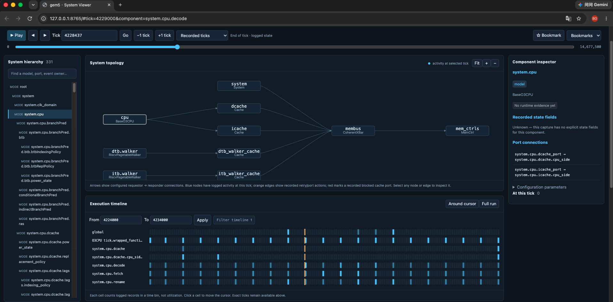

# gem5 System Viewer

A local visual log analyzer for gem5 models, ports, and Events. Inspect recorded activity at a simulation tick, navigate the system topology, and trace observations back to their original log lines.



## Features

- Searchable SimObject hierarchy, configured ports, and discovered runtime components.
- Interactive Graphviz topology with recorded activity, cache-port blocking, and retry highlights.
- Exact unsigned 64-bit tick navigation, playback, and stepping through records within a tick.
- Observed pending events with schedule, reschedule, cancellation, and execution history.
- Activity timelines, paginated log search, component inspection, and session bookmarks.
- Optional structured state/port records and Perfetto-compatible export.

**Logs are partial observations.** Unrecorded activity is unknown, not automatically idle. The viewer is a log-replay tool, not a debugger that reconstructs every internal simulator variable.

## Requirements

- Python 3.10 or newer, with SQLite 3.25 or newer.
- Graphviz (`dot` on PATH) to build datasets.
- A modern browser with BigInt support.
- Optional: Node.js 22 or newer and Chrome for browser smoke tests.

The application uses the Python standard library and buildless HTML/CSS/JavaScript. No Python or npm dependencies, CDN, or hosted service are required. The tracked `dist/` directory contains the frontend source and must remain in the repository.

## Quick start

From the repository root:

```bash
python3 viewer.py build --run examples/minimal --out data/demo
python3 viewer.py serve --data data/demo --port 8765
```

Open **http://127.0.0.1:8765/#tick=500&component=system.cpu.decode**. Stop the server with Ctrl-C. It binds only to localhost.

The included example is **synthetic**, not a performance result. At tick 500 it shows empty Decode input and a blocked cache port; at tick 1000 Decode processes an instruction; at tick 1001 the cache sends a retry.

The importer refuses to overwrite a database. Reuse `data/demo` when serving, or choose a fresh output directory when rebuilding.

## Import gem5 output

Prepare a directory containing:

| File | Purpose |
|---|---|
| `config.json` | Required: model hierarchy and port bindings |
| `debug_trace.txt` | Required: timestamped gem5 debug records |
| `stats.txt` | Optional: `simFreq`, required for Perfetto export |

```bash
python3 viewer.py build --run /path/to/gem5-output --out data/my-run
python3 viewer.py serve --data data/my-run

# Optional structured state / port / event observations:
python3 viewer.py build --run /path/to/gem5-output \
  --structured /path/to/records.jsonl --out data/instrumented-run
```

For O3 with Classic caches, `Event,Cache,CachePort,BaseXBar,Decode,Fetch,Rename` is a useful starting debug-flag set. Set `--debug-file=debug_trace.txt` when running gem5. Available flags depend on the model; inspect `gem5.opt --debug-help`. The parser accepts standard `tick: component: message` records, including padded early ticks. Formatting flags that change this structure require adapter changes. Unrecognized lines are counted in the manifest.

The dataset contains indexed SQLite records, a manifest with source hashes, and Graphviz DOT. Raw input files are unchanged. Manifests include absolute input paths; inspect them before sharing generated datasets. Generated datasets are excluded from this repository by default.

## Using the viewer

1. Select a component in the hierarchy or click a graph node/edge.
2. Enter an exact tick or move between recorded ticks. Use **Records within ticks** to inspect same-timestamp ordering.
3. Inspect pending events, the component's latest evidence, and recorded state fields.
4. Filter the activity timeline or search the evidence log. Click a record to select the state immediately after it.
5. Export to Perfetto for further timeline analysis.

Graph arrows show configured requestor-to-responder connections; responses travel back. Blue nodes have logged activity at the selected tick, including descendant activity. Orange edges show recorded retry/port actions. Red marks an explicitly recorded blocked cache port.

Timeline cells count log records; they are not utilization. Event waiting intervals represent simulation-time queue waiting, not host callback runtime. Historical messages do not become persistent model state. Explicit state deltas persist under the producer's contract of recording every change.

The tick panel displays up to 1,000 records and reports truncation. Search results are paginated. The slider provides approximate navigation; the numeric tick field remains exact.

## Development and validation

```bash
python3 -m unittest discover -s tests -v
node --check dist/app.js
```

Tests cover same-tick ordering, event cancellation/rescheduling, partial captures, padded ticks, unsigned 64-bit values, vector ports, explicit state deltas, native cache-port messages, and crossbar busy intervals.

For the optional browser smoke test, serve the synthetic demo, launch an isolated Chrome instance with `--remote-debugging-port=9231` and a separate `--user-data-dir`, then open the viewer. Run:

```bash
node tests/browser_smoke.mjs
# Override endpoints or screenshot destination if needed:
VIEWER_URL=http://127.0.0.1:8765 CDP_URL=http://127.0.0.1:9231 \
  node tests/browser_smoke.mjs artifacts/viewer.png
```

The browser test expects the bundled synthetic dataset. It checks Decode observations, unknown ticks, startup events, cache-port blocking/retry, search, and navigation. Screenshots are saved under ignored `artifacts/` by default.

The viewer was also exercised with an external full gem5 hello capture: 430,237 records, 331 configured/discovered entities, and 10 port connections. That capture and its databases are not distributed here. The screenshot above comes from that run. Its prebuilt executable's correspondence to the inspected source revision was not established. Perfetto export generation was checked; external Perfetto UI import was not verified.

## Scope and limitations

Native Classic Cache adapters recognize source-verified blocking/accepting/retry messages. They do not reconstruct arbitrary packet lifetimes. Internal registers, queue contents, persistent stage status, and complete model state require additional capture hooks. No such hooks are installed automatically.

Same-tick text order is deterministic display ordering, not queue priority or a global causal order for parallel simulation. A complete replay requires stable IDs, initial state, ordered deltas, and explicit capture-loss information. Multi-gigabyte and parallel captures have not been validated; full-window aggregation and full Perfetto export can consume substantial time and memory. Use bounded capture windows for larger runs.

## Further documentation

- [Research and existing-tool comparison](RESEARCH.md)
- [Structured trace schema and capture requirements](TRACE_SCHEMA.md)
- [Contributing](CONTRIBUTING.md)
- [Synthetic example](examples/minimal/README.md)

This is an independent tool, not an official gem5 project.
