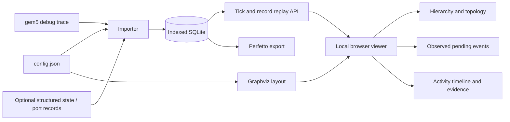

# Existing-tool research and implementation decision

Research date: 2026-10-19 (Asia/Shanghai).

## Decision

No reviewed tool documents the complete combination requested: gem5 SimObject hierarchy and port topology, infrastructure Event lifecycle, arbitrary tick/within-tick replay, and model state inspection linked to original evidence. This is a finding from a targeted public-source review, not proof that no private or unindexed tool exists.

Proceed with a local gem5-specific replay layer, Graphviz topology, and Perfetto-compatible export. Reuse the existing viewers for their strengths; do not treat timeline rendering itself as the missing invention. The missing part is a gem5 data model with trustworthy identity, state, and interaction semantics.

## Requirements used to evaluate suitability

1. Imports gem5 configuration and discovers the model hierarchy and bound ports.
2. Shows both architectural models and supporting Event/Port components.
3. Allows selection of arbitrary simulation ticks and ordering within a tick.
4. Shows model state and communication with clear evidence provenance.
5. Supports more than one specialized CPU model without rebuilding the viewer.
6. Does not infer complete internal state from debug messages that never recorded it.

## Comparison

| Tool | Documented functionality | Fit and remaining gap |
|---|---|---|
| Konata | O3PipeView/Onikiri instruction pipelines; instruction-associated logs and dependencies | Good O3 companion. Its documented input model is instruction-oriented, not complete SimObject/Port/Event state replay. |
| gem5 O3 pipe viewer | Instruction stage transitions rendered as a pipeline trace | Useful focused visualization; no integrated model topology or event-queue inspector. |
| MinorView | MinorCPU internal pipeline/buffer visualization; time controls; comments associated with units | Closest native example of replaying a model diagram. Tied to MinorTrace and the Minor pipeline, not a general O3/system infrastructure viewer. |
| gem5 GUI | Visually constructs SimObjects, edits parameters, connects ports, instantiates and runs a system | Configuration GUI, not documented per-tick execution replay. Its published roadmap lists additional result visualization as future work. |
| Catscan + perf-streams | Typed performance events, resource and transaction views, parent/child transaction navigation, trace synchronization | Strong alternative for microarchitectural transaction analysis. Reviewed docs do not supply gem5 config/port topology or EventQueue lifecycle adapters. Requires new capture/adapters for this requirement. |
| Perfetto | General timeline, slices, counters, flows, SQL analysis; supports converted custom traces | Retain as export target. It does not automatically know gem5 object ownership, port bindings, state transitions, or event scheduling semantics. |
| Graphviz / gem5 dot_writer | Configuration relationship diagrams | Reuse for topology layout. Static structure needs a synchronized replay layer for runtime behavior. |

### Primary sources reviewed

- [Konata README](https://github.com/shioyadan/Konata/blob/master/README.md): supported trace formats and instruction-oriented workflow.
- [gem5 visualization documentation](https://gem5.googlesource.com/public/gem5-website/+/7e4e26fdef6e626dcb720bdc1179f9c8db1d2588/_pages/documentation/general_docs/cpu_models/visualization.md): O3 pipe viewer and Minor viewer.
- [Minor CPU documentation](https://www.gem5.org/documentation/general_docs/cpu_models/minor_cpu): MinorTrace/MinorView structure and time navigation.
- [gem5 GUI project announcement](https://gem5.googlesource.com/public/gem5-website/+/4d84911a4dbdde715adb9ad17ff38f258fe50cf0/_posts/2020-05-29-gem5-gui.md) and [repository](https://github.com/afarooqui98/gem5_GUI): configuration editing and simulation controls.
- [Catscan repository](https://github.com/AmpereComputing/catscan), [perf-streams repository](https://github.com/AmpereComputing/perf-streams), and [authors' paper](https://arxiv.org/abs/2610.02121): resource/transaction analysis and required event-stream representation.
- [Perfetto overview](https://perfetto.dev/docs/) and [custom-data conversion](https://perfetto.dev/docs/getting-started/converting): reusable trace analysis and conversion interfaces.
- Local `riscv-o3-ppa/tools/gem5/src/python/m5/util/dot_writer.py`, `src/sim/eventq.{hh,cc}`, and saved `config.json`/traces: available topology and Event log fields.

Searches included gem5 visualization/events/ports/GUI, gem5 visual debugger, MinorView, gem5/Perfetto integration, and Catscan. The decision compares published capabilities; competitors were not installed or benchmarked. Search results are subject to indexing and publication delays. No repository activity or maintenance guarantee is inferred from search results.

## What “state at every tick” requires

A simulation tick is a timestamp, not necessarily an executed CPU cycle. Multiple events can run at one tick; many ticks have no event. A useful inspector must support both an end-of-tick snapshot and stepping through records sharing that tick. In a parallel gem5 run, text log order alone is not a globally meaningful causal order.

Ordinary debug logs are partial observations. A port may be idle, blocked, or carrying an unlogged transaction; silence cannot distinguish these. The implementation therefore supports:

- exact configuration topology;
- reconstructed event scheduling from observed actions;
- activity observations and source messages at their recorded tick;
- source-verified native Classic Cache port block/accept/retry messages, plus explicit persistent state fields and port actions from a structured sidecar;
- an explicit unknown state everywhere evidence is absent.

The supplied full hello run captures the entire execution interval with selected flags. This means complete time coverage for that run, not complete instrumentation of every component. Arbitrary internal registers, queues, packet identities, priorities, and callback duration remain unavailable unless recorded.

## Architecture selected

No gem5 source changes or remote deployment are required for the current viewer. A complete instrumentation layer is a separate extension; it must establish stable IDs, initial state, ordered deltas, and capture completeness before the tool can claim full-state replay.
